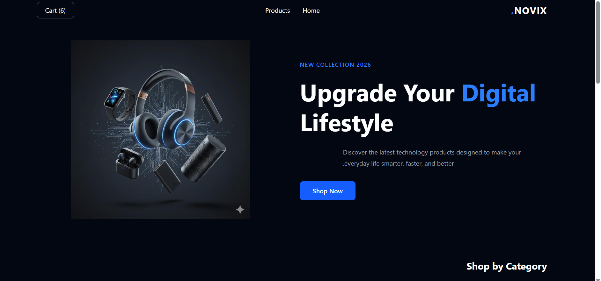

# NOVIX – Modern Tech Store

A modern and responsive e-commerce web application built with React and Tailwind CSS.

NOVIX allows users to explore technology products, search and filter items, and manage their shopping cart through a clean and user-friendly interface.

## 🌐 Live Demo

[View Live Demo](https://react-shopping-cart-ruby-two.vercel.app/)

## 📸 Preview



## ✨ Features

- Browse technology products
- Search products by name
- Filter products by category
- Add products to the shopping cart
- Increase and decrease product quantities
- Remove products from the cart
- Automatic price calculation
- Cart data persistence with LocalStorage
- Responsive user interface
- Navigation with React Router

## 🛠️ Technologies

- React
- JavaScript (ES6+)
- Tailwind CSS
- React Router DOM
- Vite
- React Icons
- LocalStorage

## 🚀 Installation

1. Clone the repository:

```bash
git clone https://github.com/fshoja/novix-store.git
```

2. Navigate to the project folder:

```bash
cd novix-store
```

3. Install dependencies:

```bash
npm install
```

4. Start the development server:

```bash
npm run dev
```

## 📦 Build

To create a production build:

```bash
npm run build
```

## 👩‍💻 Author

**Farzaneh Shoja**

Junior Front-End Developer

[GitHub Profile](https://github.com/fshoja)
